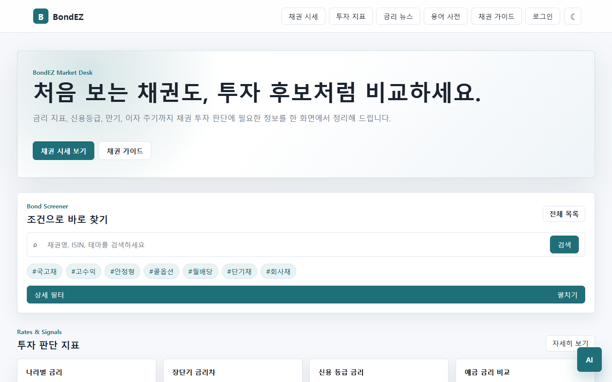
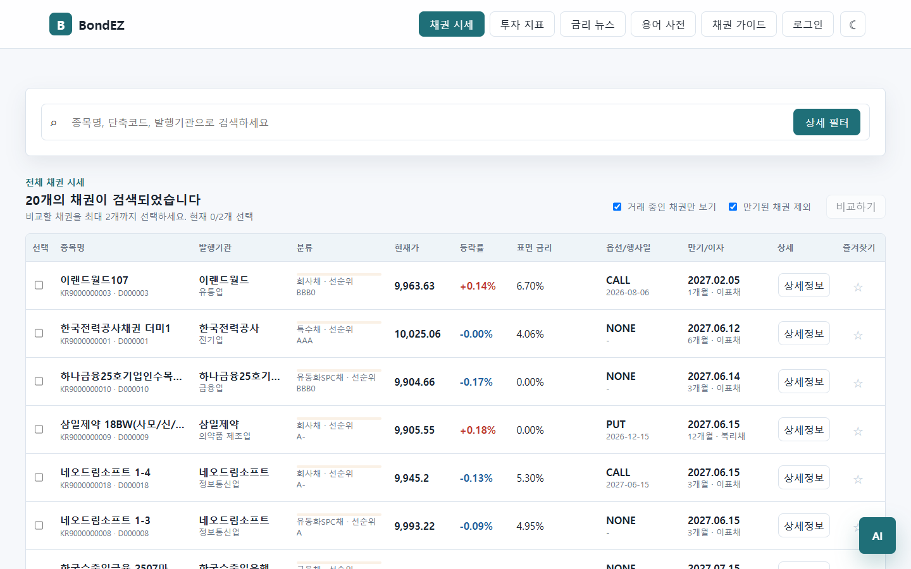
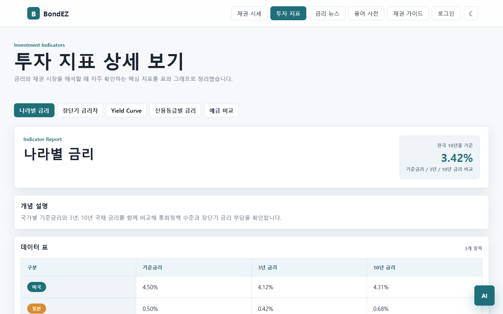
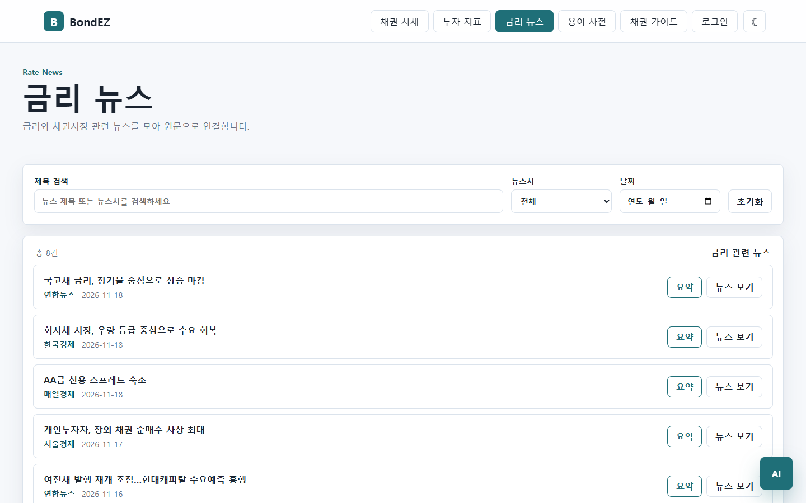
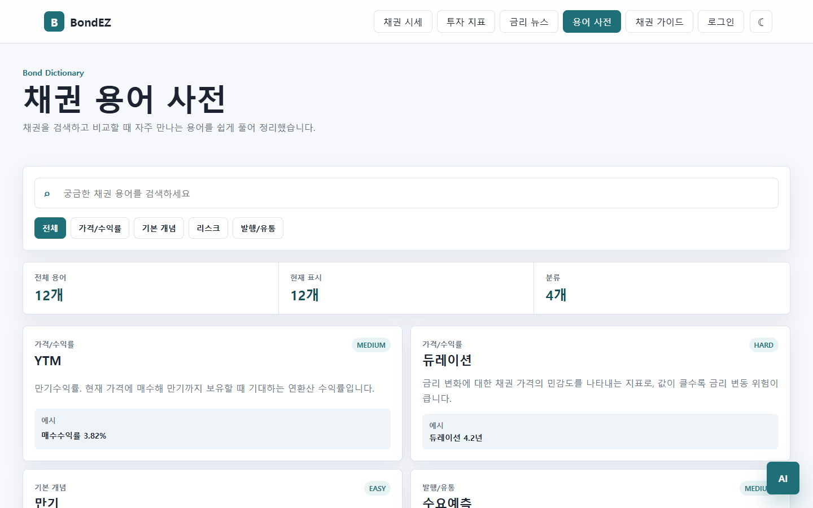
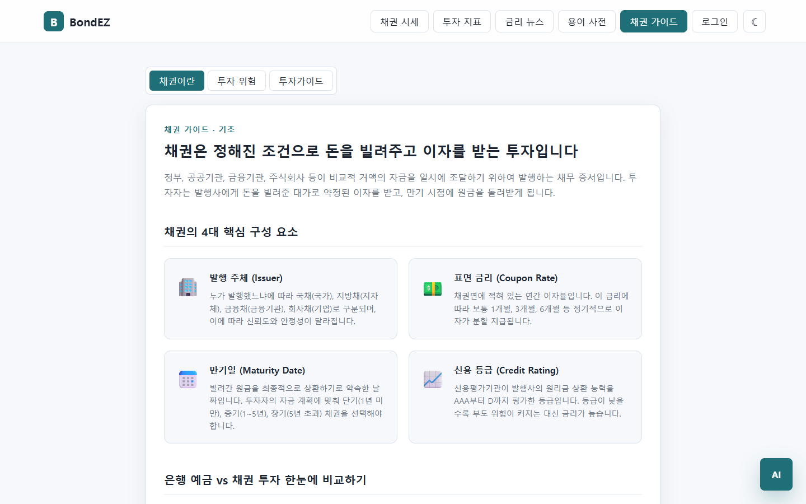
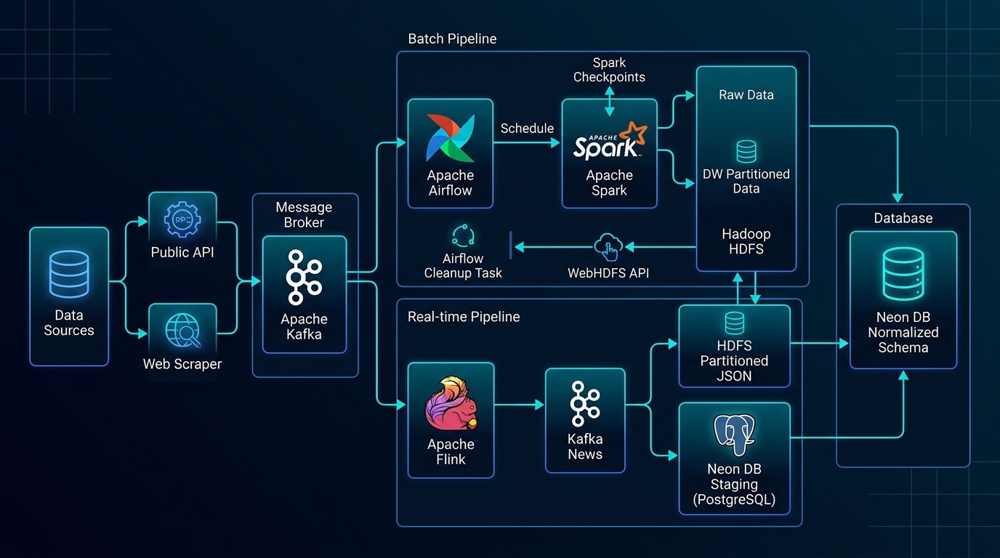
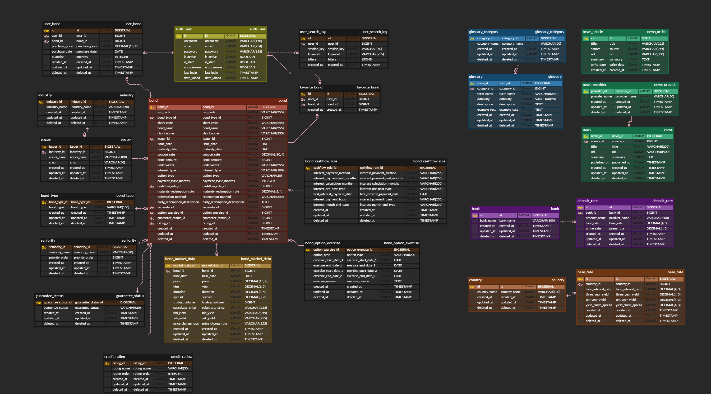

# 💵 채권이지 (Bond-EZ)

> **흩어진 채권 정보를 한곳에 모아 보여줍니다.**
> **Project Date:** 2026.05 ~ 2026.06 · **3인 팀 프로젝트**
> **Platform:** Web (Vue 3 + Django REST API) · Kafka · Spark · Flink · Airflow · HDFS 데이터 파이프라인
> **Role:** 데이터 엔지니어링 및 백엔드 아키텍처 리딩
> **Live Demo:** [bond-ez.pages.dev](https://bond-ez.pages.dev) — 회원가입 없이 둘러볼 수 있고, 가입하면 즐겨찾기·맞춤 추천까지 체험 가능 (무료 백엔드 서버라 첫 접속 시 데이터 로딩에 최대 1분)

개인 투자자에게 필요한 **채권 기본 정보, 이자 지급 일정, 신용등급, 실시간 관련 뉴스, 금융 용어 사전**을 자동으로 수집·가공해 한 화면에서 보여주는 채권 통합 정보 포털입니다.

매일 갱신되는 공시 데이터는 **배치(Airflow + Spark)** 로, 뉴스는 **실시간 스트리밍(Flink)** 으로 나눠 처리하고, 두 경로를 Kafka와 HDFS로 묶어 **장애가 나도 중단 지점부터 다시 처리하는** 데이터 파이프라인이 프로젝트의 본체입니다.

---

## 📱 실제 화면

| 홈 | 채권 시세 | 투자 지표 |
|:---:|:---:|:---:|
|  |  |  |
| 조건 검색과 투자 판단 지표로 들어가는 첫 화면 | 종목명·발행기관으로 검색하고 수익률·만기를 한 표에서 비교 | 나라별 금리, 장단기 금리차, Yield Curve를 표와 그래프로 확인 |

| 금리 뉴스 | 용어 사전 | 채권 가이드 |
|:---:|:---:|:---:|
|  |  |  |
| 금리·채권 뉴스를 모아 보고 AI 요약으로 확인 | 채권 용어를 분류별로 찾아 쉬운 설명과 예시로 확인 | 채권의 기본 개념과 투자 위험을 단계별로 안내 |

> 화면은 [라이브 데모](https://bond-ez.pages.dev)에서 찍은 것입니다.

---

## 📖 프로젝트 개요

채권 정보는 공시 사이트·증권사·뉴스 포털에 흩어져 있어, 기관 투자자에 비해 개인 투자자는 한 종목을 살펴보는 데도 여러 사이트를 오가야 합니다.
채권이지는 그 공백을 **공공데이터 + 뉴스 크롤링 + 분산 데이터 파이프라인**으로 채웁니다.

* **한 번에 조회** — 채권 스펙·이자 지급 일정·조기상환 옵션·일별 시세를 종목 단위로 통합
* **매일 자동 갱신** — 공시 데이터는 매일 00시, 금리 지표는 매일 07시에 Airflow가 수집·적재
* **쉬운 설명** — 뉴스는 LLM(Gemini)이 요약하고, 낯선 용어는 한국은행 경제금융용어 800선 기반 사전으로 풀이

### 💡 주요 기능

| 기능 | 설명 |
|---|---|
| 💵 **통합 채권 정보 조회** | 국채·금융채·회사채의 기본 스펙(표면금리, 만기일, 이자 주기)부터 이자 지급 현금흐름, 조기상환 옵션 일정까지 조회. 2개 채권 비교와 맞춤 추천 지원 |
| 📰 **실시간 뉴스 · AI 요약** | 채권 시장·거시경제 뉴스를 실시간으로 수집하고 LLM(Gemini)으로 핵심 요약 제공 |
| 📈 **거시경제 · 투자 지표** | 주요 국가 기준금리, 만기별 국고채 금리, 장단기 금리차(10Y-3Y), 예금 금리 비교, 신용등급별 평균 YTM 통계 |
| 📚 **금융 용어 사전** | 한국은행 경제금융용어 800선을 난이도별(입문·기초·중요·심화)·카테고리별로 해설 |
| 💬 **AI 투자 Q&A 챗봇** | 채권 지식·경제 지표·서비스 사용법 질문에 Gemini가 DB 조회 결과를 연동해 답변 |
| 📂 **가상 포트폴리오 · 즐겨찾기** | 관심 채권을 즐겨찾기에 등록하고, 가상 매입 내역으로 나만의 포트폴리오 관리 |

---

## 🏗️ 아키텍처 — 7계층 데이터 파이프라인

공시 데이터와 뉴스는 갱신 주기와 연산 무게가 다릅니다. 둘을 한 경로에 태우지 않고 **Kafka 토픽을 나눠 배치 경로와 실시간 경로로 이원화**했고, 전체를 수집 → 버퍼 → 저장 → 처리 → 서빙 → 모니터링 → 표현의 7계층으로 구성했습니다.

<p align="center">
  
</p>

**데이터 흐름 (수집 → 화면)**

1. **수집** — Airflow 수집기가 공공데이터 API에서 채권 스펙·시세를, 뉴스 크롤러가 60초 주기로 금융 뉴스를 가져와 Kafka에 발행 (`topic_bond_raw` / `topic_news_raw`)
2. **배치 경로** — Spark Structured Streaming이 채권 토픽을 HDFS 원천 영역(`/raw/bonds/bas_dt=YYYYMMDD/`)에 Parquet으로 적재하고, 배치 잡이 중복을 제거해 가공 영역(`/dw/bonds/`)과 DB에 적재
3. **실시간 경로** — Flink가 뉴스 토픽을 정규화해 DB Staging 테이블과 HDFS에 동시 적재(Dual-Sink)하고, DB 트리거가 최종 뉴스 테이블로 정규화
4. **서빙** — PostgreSQL(Neon DB)이 최종 데이터를 제공하고, Logstash가 변경분을 Elasticsearch 검색 인덱스(`bonds_search`)로 동기화
5. **표현 · 모니터링** — Django REST API와 Vue 화면이 사용자에게 제공하고, Prometheus·Grafana·Kibana가 지표와 검색 데이터를 관제

> 처음에는 단일 배치로 처리했지만 병목과 뉴스 지연이 생겨, 무거운 연산이 필요한 정적 공시 데이터는 배치에, 지연이 곧 품질인 뉴스는 스트리밍에 맡기는 구조로 다시 설계했습니다.

### ♻️ 라이브 데모 개편 (2026.08)

전체 빅데이터 파이프라인은 무료 호스팅으로 상시 운영이 불가능해, **웹 레이어(Vue + Django + PostgreSQL)만 분리 배포**하고 파이프라인 산출물은 시드 데이터로 대체하는 데모 구성을 추가했습니다.

```text
[Frontend]                [Backend API]              [Database]
Cloudflare Pages   ──▶    Render (Django+gunicorn) ──▶ Neon PostgreSQL
frontend-pjt/dist         backend-pjt                  demo 스키마+시드
```

| 분류 | 내용 |
|---|---|
| **배포 인프라** | 프로덕션 설정 추가(CORS·교차 사이트 쿠키·WhiteNoise·gunicorn·DATABASE_URL), Elasticsearch는 무료 호스팅이 없어 **설계되어 있던 Postgres ORM 폴백**으로 대체 |
| **DB 부트스트랩** | Django 마이그레이션(0001, `id` PK)과 파이프라인 스키마(`bond_id` PK)의 불일치를 해결하는 `bootstrap_demo` 커맨드 신설 — 모델 정의 기준 스키마 생성 + 선택적 fake migrate + 시드 적재를 한 번에 처리 ([deploy/](backend-pjt/deploy/)) |
| **버그 수정** | unmanaged 모델의 `db_column` 변경이 마이그레이션 상태에 누락되어 외부 앱 FK가 존재하지 않는 `bond(id)`를 참조하던 문제(0005 상태 정렬 마이그레이션), 챗봇 히스토리 전역 dict 무한 누적(LRU 캡 적용) |
| **개선** | 뉴스 요약을 무거운 dspy 의존에서 **langchain-Gemini 직접 호출**로 교체(검증·교정 로직은 유지, 무료 호스팅 메모리 대응), `GOOGLE_API_KEY`로 잘못 안내되던 환경변수를 실제 코드가 읽는 `GEMINI_API_KEY`로 정정 |
| **정리** | 미사용 mainpage 앱·dspy 전용 스크립트·Vite 스캐폴드 제거, API 명세 PDF는 docs/로 이동, requirements 경량화(dspy·elasticsearch·langchain 우산 패키지 제외) |

---

## 🔀 배치 · 스트림 이원화 파이프라인

같은 Kafka에서 출발하지만 두 경로는 처리 엔진·적재 방식·장애 대비가 다릅니다.

| 구분 | 배치 경로 (채권 공시) | 실시간 경로 (뉴스) |
|---|---|---|
| **대상 데이터** | 채권 기본 정보 · 이자 지급 및 옵션 일정 · 일별 시세 · 금리 지표 | 네이버 금융 주요뉴스 · 연합인포맥스 채권 뉴스 |
| **수집** | Airflow DAG 2개 — 채권 풀 파이프라인(매일 00시), ECOS/FRED 금리(매일 07시) | 크롤러가 60초 주기로 폴링해 신규 기사만 발행 |
| **처리 엔진** | Spark (Structured Streaming + Batch) | PyFlink |
| **적재** | HDFS `raw/` Parquet(snappy) → ISIN 기준 중복 제거 → `dw/` → DB Staging → `normalize_bonds_staging()` 프로시저로 정규화 | DB Staging(`news_article`) + HDFS JSON 동시 적재 → 트리거로 `news` · `news_provider` 정규화 |
| **장애 대비** | Kafka 오프셋 + HDFS 체크포인트(`/spark/checkpoints/kafka_to_hdfs`)로 중단 지점부터 재처리 | Flink 체크포인트 + HDFS 원본 백업 |
| **부가 처리** | 이자·옵션 상세는 실행당 최대 100건씩 점진 적재, API 장애 시 마스터 데이터로 일정 계산(Fallback), 30일 지난 HDFS 파티션 자동 삭제 | Flink는 고속 인서트만 맡고 중복 검사·정규화는 DB에 위임 |

**채권 풀 파이프라인 DAG 순서:** `collect_api_to_kafka` → `spark_kafka_to_hdfs` → `spark_hdfs_to_postgres` → `ingest_option_cashflow_details` · `ingest_daily_market_data` → `verify_db_load` → `hdfs_cleanup_task`

---

## 📊 데이터 규모와 실측

| 단계 | 결과 |
|---|---|
| **컨테이너 구성** | Docker 컨테이너 **20개**를 컴포즈 3개로 분리 운영 — 데이터 파이프라인 13 · 웹 서비스 5 · 모니터링 2 |
| **배치 스케줄** | Airflow DAG **2개** — 채권 풀 파이프라인(매일 00시), ECOS/FRED 금리 수집(매일 07시) |
| **실시간 수집** | 뉴스 크롤러 **60초 주기** 폴링 → Kafka 발행 |
| **HDFS 적재** | 일일 채권 파티션 **약 19~28MB** Parquet(snappy), **30일** 보존 후 자동 삭제 |
| **저장 공간** | 압축 포맷 적용과 메모리 내 중복 사전 필터링으로 **70% 절약** |
| **관계형 DB** | 테이블 **17종** — 채권 마스터 · 현금흐름 · 옵션 · 시세, 뉴스 Staging/정규화, 용어 사전, 포트폴리오 |

<p align="center">
  
</p>

---

## 🛠️ 기술 스택

| 영역 | 스택 |
|---|---|
| **프론트엔드** |    |
| **백엔드** |      |
| **데이터 파이프라인** |      |
| **AI** |  langchain-google-genai (챗봇 · 뉴스 요약) |
| **인프라 · 모니터링** |     |
| **데모 배포** |   Neon PostgreSQL |

---

## 💥 트러블 슈팅

### 1. 단일 배치로는 뉴스가 늦게 도착했다
* **현상:** 초기에는 모든 데이터를 하나의 배치로 처리해 병목이 생기고, 뉴스가 화면에 늦게 반영됨.
* **원인:** 하루 한 번 갱신되는 공시 데이터와 수시로 들어오는 뉴스가 같은 경로·같은 주기를 공유.
* **해결:** Kafka 토픽을 `topic_bond_raw` / `topic_news_raw`로 분리하고, 무거운 연산이 필요한 공시 데이터는 Airflow + Spark 배치에, 뉴스는 Flink 스트리밍에 맡기는 이원화 구조로 재설계.

### 2. Flink 안의 무거운 동기 연산이 수집 속도를 막았다
* **현상:** 스트림 처리 중 DB 조인과 중복 검사를 함께 수행하자 수집 속도가 떨어짐.
* **원인:** 스트림 엔진이 레코드마다 DB를 조회하는 동기 연산을 떠안고 있었음.
* **해결:** Flink는 Staging 테이블(`news_article`)에 고속 인서트만 하도록 역할을 줄이고, 정규화·중복 검증은 DB 트리거(`sync_news_article_to_erd`)에 위임. 압축 포맷과 메모리 내 중복 사전 필터링을 더해 저장 공간 70% 절약. ([상세 문서](docs/troubleshooting_staging_vs_normalized.md))

### 3. 장애가 나면 어디까지 처리했는지 알 수 없었다
* **현상:** 파이프라인이 중간에 멈추면 재시작 시 데이터가 유실되거나 중복 적재될 위험.
* **해결:** Kafka 오프셋과 Spark Structured Streaming의 HDFS 체크포인트를 결합해 중단 지점부터 이어서 처리하도록 구성. 뉴스는 DB와 HDFS에 동시 적재(Dual-Sink)해 한쪽에 문제가 생겨도 원본이 남도록 함.

### 4. 실시간 적재가 소형 파일을 쏟아냈다
* **현상:** 실시간 적재로 HDFS에 작은 파일이 대량 생성되어 네임노드에 부하가 걸림.
* **원인:** HDFS는 파일 개수만큼 네임노드가 메타데이터를 관리하므로 소형 파일이 많을수록 불리.
* **해결:** 100MB 단위로 버퍼링한 뒤 병합해 쓰는 방식(Merge Write)으로 변경.

### 5. 검색 인덱스 동기화가 매번 전체를 훑었다
* **현상:** Logstash가 DB를 전체 조회하는 쿼리로 Elasticsearch를 동기화해 병목 발생.
* **해결:** 채권과 연관 테이블의 `updated_at` 중 가장 최근 값을 추적 컬럼으로 삼아, 5분마다 변경분만 가져오는 증분 추출로 전환.

---

## 📂 디렉터리 구조

```text
Bond-EZ/
├── backend-pjt/                   # Django REST API
│   ├── apps/                      # 도메인 앱 — accounts·bonds·chat·glossary·indicators·news·portfolios·search·common
│   ├── config/                    # Django 설정
│   └── deploy/                    # 라이브 데모용 스키마·시드 SQL
├── frontend-pjt/                  # Vue 3 + Vite 프론트엔드
│   └── src/
│       ├── api/                   # 백엔드 통신 래퍼·캐시 모듈
│       ├── components/            # 공통 UI (내비게이션·플로팅 챗봇)
│       └── pages/                 # 화면 단위 컴포넌트 (홈·시세·상세·비교·지표·뉴스·사전·가이드)
├── data-pjt/                      # 데이터 파이프라인
│   ├── airflow/dags/              # 채권 풀 파이프라인 DAG · 금리 수집 DAG · 세부 태스크
│   ├── flink/                     # 실시간 뉴스 듀얼 싱크 적재 (PyFlink)
│   ├── producer/                  # 뉴스 크롤러 · ECOS/FRED 금리 수집기
│   ├── glossary/                  # 경제금융용어 PDF 파싱·적재
│   ├── logstash/                  # DB → Elasticsearch 증분 동기화 파이프라인
│   └── postgres/                  # DB 스키마 · 정규화 프로시저·트리거
├── monitoring/                    # Prometheus · Grafana 설정
├── docs/                          # 시작 가이드 · 운영 가이드 · 파이프라인 요약 · 챗봇 명세
├── images/                        # 아키텍처 다이어그램 · ERD
├── docker-compose.yml             # 웹 서비스 (Django · Vue · Elasticsearch · Kibana · Logstash)
├── docker-compose-data.yml        # 데이터 파이프라인 (Kafka · Hadoop · Spark · Flink · Airflow)
├── docker-compose-monitoring.yml  # 관제 (Prometheus · Grafana)
├── docker-compose.demo.yml        # 웹 데모 스택 (Vue + Django + Postgres, 시드 자동 적재)
└── service.sh · data.sh · monitoring.sh   # 영역별 구동 스크립트
```

---

## 🚀 실행 방법

**요구 사항:** Docker Desktop · (전체 파이프라인) 공공데이터포털 인증키 · (AI 기능) Gemini API 키

**데모 스택 (권장)** — 프론트 · 백엔드 · PostgreSQL이 한 번에 뜨고 데모 시드(오늘 날짜 기준 시세 90일 시계열)가 자동 적재됩니다.

```bash
docker compose -f docker-compose.demo.yml up --build
# 프론트 http://localhost:5173 · 백엔드 API http://localhost:8000/api/v1
# AI 챗봇·뉴스 요약까지 쓰려면 GEMINI_API_KEY=<키> 를 앞에 붙여 실행
```

**데모 백엔드 직접 실행**

```bash
cd backend-pjt
pip install -r requirements.txt
cp ../.env.example .env            # DATABASE_URL 등 채우기
python manage.py bootstrap_demo    # 스키마 + 마이그레이션 + 시드 (재실행 안전)
python manage.py runserver
```

**전체 파이프라인**

```bash
cp .env.example .env     # DATA_PORTAL_API_KEY · GEMINI_API_KEY · DB 접속 정보 입력
sh service.sh up         # 웹 서비스 — Elasticsearch·Kibana 기동 → Django 마이그레이션 (최초 2~3분)
sh data.sh up            # 파이프라인 — Kafka·HDFS·Spark·Flink·Airflow 기동 → HDFS 초기화 → 용어 사전 적재
sh monitoring.sh up      # 관제 — Prometheus·Grafana (선택)
```

최초 적재는 Airflow 콘솔(http://localhost:8081, 로컬 기본 계정 `admin` / `admin`)에서 `bond_full_pipeline_dag`를 켜고 한 번 수동 실행합니다. 단계별 절차와 적재 검증 SQL, 서비스별 포트는 [운영 가이드](docs/OPERATIONS_GUIDE.md)에 있습니다.

---

## 📚 문서

| 문서 | 내용 |
|---|---|
| [GETTING_STARTED.md](docs/GETTING_STARTED.md) | 사전 요구사항 · 영역별 구동 스크립트 · 문제 해결 Q&A |
| [OPERATIONS_GUIDE.md](docs/OPERATIONS_GUIDE.md) | 계층별 아키텍처 · HDFS 구조 · DB 테이블 명세 · REST API 명세 · 서비스 포트 |
| [pipeline_ingestion_summary.md](docs/pipeline_ingestion_summary.md) | 데이터 출처 · 오픈 API 명세 · 파이프라인 구현 세부 |
| [troubleshooting_staging_vs_normalized.md](docs/troubleshooting_staging_vs_normalized.md) | HDFS와 DB의 역할 분담 · Staging과 정규화 테이블을 나눈 이유 |
| [chatbot_chain_spec.md](docs/chatbot_chain_spec.md) · [chatbot_internal_logic.md](docs/chatbot_internal_logic.md) | AI 챗봇 처리 체인 · 내부 로직 |
| [project_plan.md](docs/project_plan.md) | 프로젝트 기획서 |

## 데이터 출처

- [공공데이터포털](https://www.data.go.kr) (금융위원회) — 채권기본정보 · 채권권리일정정보 · 채권권리행사정보 · 채권시세정보, 한국예탁결제원 채권정보서비스(장애 대비 백업)
- 금리 지표 — 한국은행 ECOS · FRED
- 뉴스 — [네이버 금융 주요뉴스](https://finance.naver.com/news/mainnews.naver) · [연합인포맥스](https://news.einfomax.co.kr)
- 용어 사전 — 한국은행 「경제금융용어 800선」
